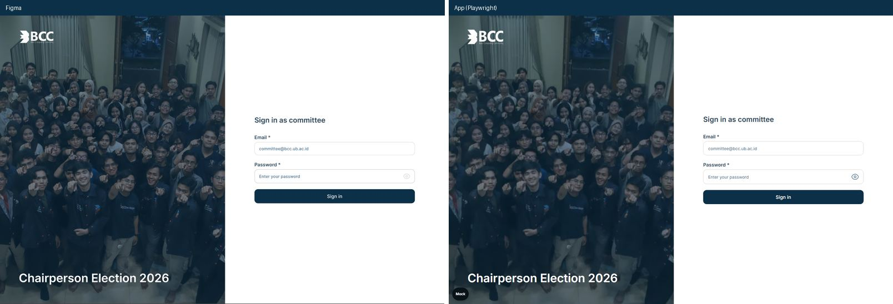
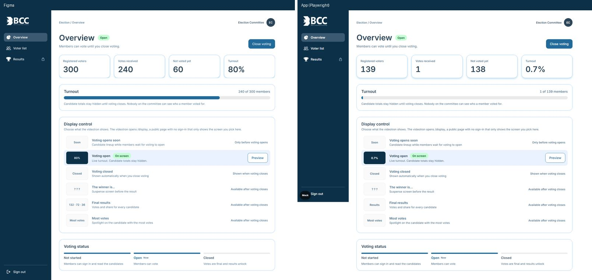
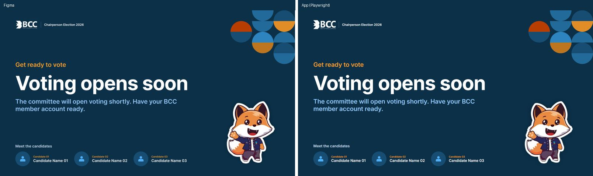
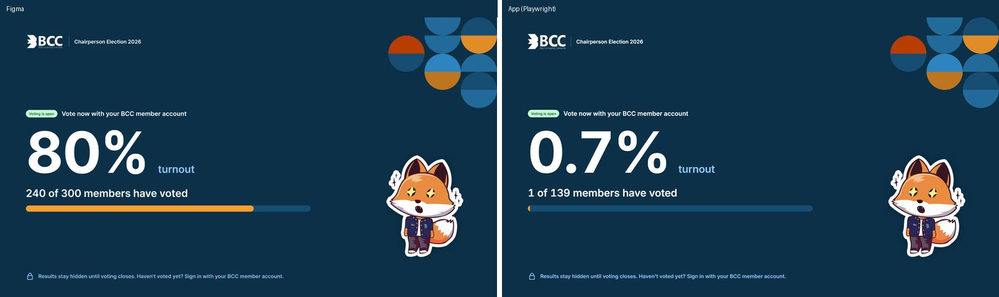
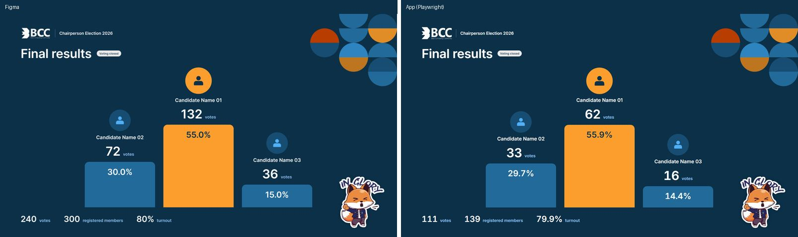
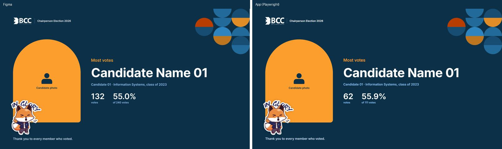

# QA report — Phase 6 (hardening & QA)

Date: 17 November 2026. Scope: spec §10 against the mock API (`pnpm build:mock`), plus the production build (`pnpm build`) for the bundle and JS-budget gates. ✅ = verified, ❌ = not done or failing, ⚠️ = done with a caveat.

## 1. Summary

All automated gates pass. The load test found one real leak, now fixed: every previous voter's sign-in page stayed in memory on a booth. Hardening also fixed clipped names on narrow phones, unused image preloads that logged browser warnings, and a JS budget overrun on signed-in pages. Still open: the manual checks that cannot be automated here (screen readers, real iOS / Android devices, kiosk mode, a real 4-hour run on the videotron laptop) and a local Firefox run (Windows blocks the downloaded browser; CI runs it).

## 2. Automated gates

| Gate                                                         | Result | Notes                                                                                                                                                                                                          |
| ------------------------------------------------------------ | ------ | -------------------------------------------------------------------------------------------------------------------------------------------------------------------------------------------------------------- |
| `pnpm lint` (0 warnings)                                     | ✅     | ESLint strict type-checked + jsx-a11y strict                                                                                                                                                                   |
| `pnpm typecheck`                                             | ✅     | TypeScript 6 strict                                                                                                                                                                                            |
| `pnpm format:check`                                          | ✅     |                                                                                                                                                                                                                |
| `pnpm test:coverage` (≥ 80 % `features/`, `lib/`)            | ✅     | 208 tests; statements 96.0 %, branches 90.7 %, functions 95.9 %, lines 98.2 %                                                                                                                                  |
| `pnpm build` + `pnpm check:bundle`                           | ✅     | No demo accounts or mock code in 548 output files                                                                                                                                                              |
| `pnpm check:js` (JS budget)                                  | ✅     | See §2.1                                                                                                                                                                                                       |
| `pnpm e2e`                                                   | ✅     | 206 tests on desktop Chrome, Pixel 7, iPhone 14, Edge, WebKit (incl. load and endurance). 3 iPhone failures in the full run were the new console guard catching a WebKit notice; allowed (§6) and re-run green |
| axe (no serious / critical)                                  | ✅     | Every captured screen in `tests/visual` and `tests/a11y`                                                                                                                                                       |
| Console clean (no errors / warnings)                         | ✅     | Shared fixture `tests/fixtures.ts` fails any test that logs one (§6)                                                                                                                                           |
| Lighthouse mobile, voter page `/sign-in`                     | ✅     | Performance 97–99, Accessibility 100, Best Practices 100                                                                                                                                                       |
| Lighthouse desktop, `/sign-in`, `/admin/sign-in`, `/display` | ✅     | 100 / 100 / 100 on all three pages                                                                                                                                                                             |
| Build without errors or warnings                             | ✅     |                                                                                                                                                                                                                |

### 2.1 First-load JavaScript (Brotli, production build)

Budget (PLAN, 9 Nov): app code ≤ 80 KB and total ≤ 200 KB per page. "Framework" = what the 404 page loads (140.7 KB: Next, React, root providers).

| Page                        | App code   | Total        | Page             | App code | Total |
| --------------------------- | ---------- | ------------ | ---------------- | -------- | ----- |
| `/sign-in`                  | 48.0       | 188.7        | `/admin/sign-in` | 46.3     | 187.0 |
| `/candidates`               | 56.5       | 197.2        | `/admin`         | 58.8     | 199.5 |
| `/candidates/cand-01`       | 54.5       | 195.2        | `/admin/voters`  | 58.5     | 199.2 |
| `/vote/submitted`           | 50.4       | 191.1        | `/admin/results` | 58.5     | 199.2 |
| `/vote/error`               | 52.4       | 193.1        | `/display`       | 34.6     | 175.3 |
| `/already-voted`, `/closed` | 50.4, 49.7 | 191.1, 190.4 |                  |          |       |

Before Phase 6 the signed-in pages were at 202–216 KB. Fixes: `zod/mini` on the client, Zod out of the shared baseline, copy split per area, own toast instead of Radix Toast, Vaul loaded on phones only. ⚠️ Admin pages have 0.5 KB of headroom.

## 3. E2E scenarios (spec §10)

| Scenario                                                                                                                         | Result | Where                                                                             |
| -------------------------------------------------------------------------------------------------------------------------------- | ------ | --------------------------------------------------------------------------------- |
| Happy path desktop + Pixel 7 + iPhone 14, sign in → submitted → auto sign-out                                                    | ✅     | `e2e/voter.spec.ts`                                                               |
| Sign-in failed, not a voter, already voted                                                                                       | ✅     | `voter.spec.ts`                                                                   |
| NOT_STARTED, the committee opens, the voter's UI changes by itself                                                               | ✅     | `voter.spec.ts`, `cross-role.spec.ts` (through the panel UI)                      |
| Voting closed while the dialog is open; reopened while on `/closed`                                                              | ✅     | `voter.spec.ts`, `cross-role.spec.ts`                                             |
| Submit fails → Try again, same Idempotency-Key, no double vote; double click = 1 request                                         | ✅     | `voter.spec.ts`                                                                   |
| Back / reload after submit; 401; offline → online                                                                                | ✅     | `voter.spec.ts`                                                                   |
| Idle timeout and auto sign-out; Back shows nothing of the previous voter                                                         | ✅     | `voter.spec.ts`                                                                   |
| Admin open → close → reopen → close                                                                                              | ✅     | `cross-role.spec.ts` (with a booth and the display following live)                |
| Results locked / unlocked                                                                                                        | ✅     | `admin.spec.ts`                                                                   |
| Display control: active, disabled, optimistic + rollback                                                                         | ✅     | `admin.spec.ts`, unit tests                                                       |
| Voter list: search, no results, paging, URL in sync                                                                              | ✅     | `admin.spec.ts`                                                                   |
| Two committee members (`STATE_CONFLICT`)                                                                                         | ✅     | `admin.spec.ts`, `cross-role.spec.ts`                                             |
| Display follows the active screen, falls back when the connection drops, never changes without a committee command, tie variants | ✅     | `display.spec.ts`, `cross-role.spec.ts`, `visual/display-screens.spec.ts`         |
| Extreme data: 1 / 6 candidates, very long names, 0 votes, tie, 139 and 1,000 voters                                              | ✅     | `hardening.spec.ts` (voter pages), `admin.spec.ts`, visual specs (admin, display) |

## 4. Visual & responsive

| Check                                                                                                | Result | Notes                                                                                                                                         |
| ---------------------------------------------------------------------------------------------------- | ------ | --------------------------------------------------------------------------------------------------------------------------------------------- |
| Screenshots at 360 / 390 / 768 / 1024 / 1280 / 1512 (voter, admin) and 1920×1080, 1366×768 (display) | ✅     | `tests/visual/*`, saved to `test-results/visual/`                                                                                             |
| Compared with Figma `get_screenshot` per frame                                                       | ✅     | Done per phase; differences are in `DEVIATIONS.md`. Samples below                                                                             |
| No horizontal scroll                                                                                 | ✅     | Every visual capture, zoom and landscape tests                                                                                                |
| No clipped text                                                                                      | ✅     | Automated (`tests/visual/checks.ts`): overflow-hidden / ellipsis elements whose text does not fit. Found and fixed the mobile action bar (§7) |
| Nothing stacked on text                                                                              | ✅     | Automated: no Brace sticker overlaps text by more than 2 px. Decorations sit behind content by design (DEVIATIONS #14)                        |
| Zoom 200 %                                                                                           | ✅     | 640×400 viewport (= 1280×800 at 200 %), voter and committee pages                                                                             |
| Phone landscape                                                                                      | ✅     | Pixel 7 and iPhone 14 landscape, full vote flow                                                                                               |

|                                            |                                        |
| ------------------------------------------ | -------------------------------------- |
|  |  |
|         |    |
|      |     |

Numbers differ on purpose: Figma shows placeholders (300 voters, 132 / 72 / 36), the app shows mock data and one decimal (DEVIATIONS #37, #58).

## 5. Accessibility (WCAG 2.1 AA)

| Check                                                                                              | Result | Notes                                                                  |
| -------------------------------------------------------------------------------------------------- | ------ | ---------------------------------------------------------------------- |
| Every flow with the keyboard only                                                                  | ✅     | Vote and committee open voting, Tab / Enter only (`hardening.spec.ts`) |
| Logical focus order, focus trapped in dialogs, focus returns to the trigger                        | ✅     | e2e + unit tests                                                       |
| Focus ring always visible (2 px)                                                                   | ✅     | Asserted on every element reached with Tab in the keyboard tests       |
| Labels and errors linked (`aria-describedby`)                                                      | ✅     | Unit tests (fields, sign-in)                                           |
| State changes announced (`aria-live`): submitting, voting opened / closed, errors, display changes | ✅     | Unit + e2e                                                             |
| Contrast ≥ 4.5:1 (large ≥ 3:1)                                                                     | ✅     | axe on every capture                                                   |
| `prefers-reduced-motion`                                                                           | ✅     | e2e: dialog animation duration ≈ 0                                     |
| Alternative text                                                                                   | ✅     | axe; decorations `aria-hidden`                                         |
| VoiceOver / NVDA, vote flow                                                                        | ❌     | Manual test still to do (§9)                                           |

## 6. Browsers & devices

| Browser                        | Result                | Notes                                                                                                   |
| ------------------------------ | --------------------- | ------------------------------------------------------------------------------------------------------- |
| Chrome (desktop)               | ✅                    | Full suite                                                                                              |
| Edge (desktop, installed Edge) | ✅                    | `@cross-browser` tests (cross-role flow, voter happy path)                                              |
| Safari macOS                   | ⚠️                    | Playwright WebKit on Windows, `@cross-browser` tests. Not real Safari                                   |
| Safari iOS                     | ⚠️                    | iPhone 14 emulation (WebKit), all voter tests. Not a real device                                        |
| Chrome Android                 | ⚠️                    | Pixel 7 emulation (Chromium), all voter tests. Not a real device                                        |
| Firefox                        | ❌ locally / ✅ in CI | Windows refused to run the downloaded Playwright Firefox ("Permission denied"); CI installs and runs it |
| Booth in fullscreen / kiosk    | ❌                    | Manual test still to do; display fullscreen (F) is automated                                            |

The console guard allows only browser noise the app cannot control: network messages for failures a test causes on purpose (401, 409, aborted routes, offline), and WebKit's "not cross-origin isolated" notice. The app sends COOP without COEP on purpose: COEP `require-corp` would block candidate photos from the backend's host, and the app does not use `SharedArrayBuffer`.

## 7. Load & resilience

| Check                                            | Result  | Measured                                                                                                                                                                                                                       |
| ------------------------------------------------ | ------- | ------------------------------------------------------------------------------------------------------------------------------------------------------------------------------------------------------------------------------ |
| 3 booths, 139 voters, in parallel through the UI | ✅      | 138 votes in 106 s; 139 / 139 counted, one request per vote, panel shows 100.0 %                                                                                                                                               |
| No leak on a booth (no reload between voters)    | ✅      | 20 voters: DOM nodes 627 → 627, listeners 543 → 543, heap +1.1 MB (levels off: 40-voter probe 6.7 → 7.7 MB)                                                                                                                    |
| Intervals stop on unmount                        | ✅      | Voter list polling stops when leaving it; `/display` closes its stream and stops polling on client-side navigation                                                                                                             |
| Display stable > 4 h without reload              | ✅ / ⚠️ | Simulated with a fake clock on the polling path: 4,801 polls, 48 screen changes, heap 5.0 → 5.3 MB, nodes stable, listeners 409 → 409, never "Reconnecting…". The SSE path and a real 4-hour run on the laptop are manual (§9) |

## 8. Front-end security

| Check                                                                                         | Result | Notes                                                                                                        |
| --------------------------------------------------------------------------------------------- | ------ | ------------------------------------------------------------------------------------------------------------ |
| No token or secret in the bundle                                                              | ✅     | `check:bundle`; `NEXT_PUBLIC_*` = mock flag and booth flag only                                              |
| No voter / committee data in web storage                                                      | ✅     | e2e after a vote and an admin session: `localStorage` and `sessionStorage` empty                             |
| Session cookies HttpOnly, SameSite=Lax, not readable from JS                                  | ✅     | e2e                                                                                                          |
| Security headers (CSP with nonce, frame-ancestors, X-Frame-Options, Referrer-Policy, nosniff) | ✅     | `platform.spec.ts`                                                                                           |
| No `dangerouslySetInnerHTML`                                                                  | ✅     | ESLint `react/no-danger`                                                                                     |
| `/display` payload does not leak                                                              | ✅     | e2e: open state = totals only; "The winner is…" = candidate numbers only; votes only after "Show on display" |
| Admin routes / API need a session                                                             | ✅     | `platform.spec.ts`                                                                                           |

## 9. Bugs found and fixed

| Phase | Bug                                                                                                                                                                                                                               | Fix                                                                                  |
| ----- | --------------------------------------------------------------------------------------------------------------------------------------------------------------------------------------------------------------------------------- | ------------------------------------------------------------------------------------ |
| 6     | Booth memory: every previous voter's sign-in page stayed in memory for 5 min (+375 DOM nodes and +44 listeners per voter). Found by the load test; heap-snapshot path: timer → finished mutation → form callbacks → inputs → page | Mutations `gcTime: 0`                                                                |
| 6     | Browser warnings "preloaded but not used" on `/sign-in` (logo, Brace, A0 photo rendered twice per breakpoint, both preloaded)                                                                                                     | Hidden duplicates load `eager` instead of `priority`                                 |
| 6     | Mobile action bar cut the name at 360 px ("Candidate Name 0…"); very long names cut at every width                                                                                                                                | Name wraps; the bar publishes its height so content padding follows (DEVIATIONS #69) |
| 6     | JS over budget on signed-in pages (up to 216.5 KB)                                                                                                                                                                                | §2.1                                                                                 |
| 6     | Test infrastructure: random `ECONNRESET` on API calls in tests                                                                                                                                                                    | Test server keeps idle connections 70 s                                              |
| 5     | An open `/display` stopped following after a mock data reset (versions restarted at 1)                                                                                                                                            | Mock keeps versions increasing, like a real backend                                  |
| 5     | Final results with zero votes implied a ranking (podium order)                                                                                                                                                                    | Number order when nobody has votes                                                   |
| 4     | Double click on a confirm button sent two requests                                                                                                                                                                                | Ref guard on confirm handlers                                                        |
| 4     | Back after committee sign-out could stay on a spinner                                                                                                                                                                             | Sign-in page resets the "session ending" flag                                        |

## 10. Remaining risks and manual checks

1. **Screen readers**: VoiceOver (iOS / macOS) and NVDA (Windows) on the vote flow. Not automatable here.
2. **Real devices**: iOS Safari and Chrome on Android phones; the booth laptops in fullscreen / kiosk mode (auto sign-out, idle dialog, no browser autofill).
3. **Videotron**: a real 4-hour run on the display laptop with the real backend's stream, wake lock and fullscreen.
4. **Firefox locally**: allow Playwright's Firefox in Windows Security, or rely on CI.
5. **Admin JS budget**: 0.5 KB of headroom; the next admin feature will need a size check (`pnpm build && pnpm check:js`).
6. **Mobile Lighthouse for `/display` and `/admin/sign-in`** is not gated: both are desktop-only (spec §6), and the display paints its content only after the live payload arrives. Measured mobile performance: admin sign-in 95–98, display 86–90.
7. **Backend contract**: everything above runs against the ASSUMED contract (`API_CONTRACT.md`). Rerun the whole QA once the real backend is connected.

## 11. How to rerun

```bash
pnpm lint && pnpm typecheck && pnpm format:check && pnpm test:coverage
pnpm build && pnpm check:bundle && pnpm check:js
pnpm build:mock && pnpm e2e        # all projects; add --project=desktop-chrome for one
pnpm lhci                          # needs the mock build
```

Cross-browser tests are tagged `@cross-browser` (projects `edge`, `firefox`, `webkit`); load and endurance tests live in `tests/load` (Chromium only).

## 12. Phase 8: backend API integration (17 Nov 2026)

What changed: the app speaks the backend doc "API Pilketum BCC" through the BFF (`src/lib/bff`), with the committee Candidates pages (A6–A8), the two-step sign-in step and the results export. The mock backend implements the same doc.

| Gate                                               | Result                                                                                                                                                                     |
| -------------------------------------------------- | -------------------------------------------------------------------------------------------------------------------------------------------------------------------------- |
| `pnpm format:check`, `pnpm lint`, `pnpm typecheck` | Pass, 0 warnings                                                                                                                                                           |
| `pnpm test:coverage`                               | 270 tests pass; coverage 92.3 % lines-statements / 87.5 % branches / 92.9 % functions / 95.0 % lines                                                                       |
| `pnpm build` + `pnpm check:bundle`                 | Pass (608 files, no mock code)                                                                                                                                             |
| `pnpm check:js`                                    | All 15 measured pages within budget. Tightest: `/admin`, `/admin/results` 199.4 KB, `/admin/candidates` 199.0 KB; voter `/candidates` 196.6 KB                             |
| `pnpm contract:openapi --check`                    | Up to date                                                                                                                                                                 |
| `pnpm contract:check --mock`                       | 26 pass, 0 fail, 9 skipped (writes and the OTP step)                                                                                                                       |
| Playwright, all projects                           | 221 of 224 passed. Not passing: Firefox ×2 (Windows refuses to start `firefox.exe` on this laptop; runs in CI) and the single-booth memory check, fixed afterwards (below) |
| Playwright, after the last fixes                   | Candidates e2e + A6–A8 visual (16/16) and single-booth memory check 3/3                                                                                                    |

Found and fixed during this phase:

- Single-booth memory: with real candidate photos the booth kept ≈ 3 DOM nodes per voter. Two causes: `<Image>` instances (replaced by `getImageProps` + ``, `CandidateImage`), and the test leaving the ballot while the photos were still loading (now waits for them, as a voter would see them).
- A double "Show on display" in quick succession was ignored because the confirm guard waited for the overview refetch; the refetch is no longer awaited.
- JS budget: the new endpoints and screens took admin pages to 206 KB and the form to 221 KB. Fixed with a schema-free route table for the browser, copy split per area, and lazy loading of the election dialog and the candidate form (PLAN 2026-11-17).
- Candidate row overflowed at 360 px; contrast of an empty dropdown on the error background was 4.49:1; `aria-required` on the photo buttons (axe).

Still manual / open: the checks in §10 against a real staging backend, Lighthouse rerun on staging, and the backend questions in `docs/BACKEND_QUESTIONS.md` (#1 client IP behind the BFF is the most important).
